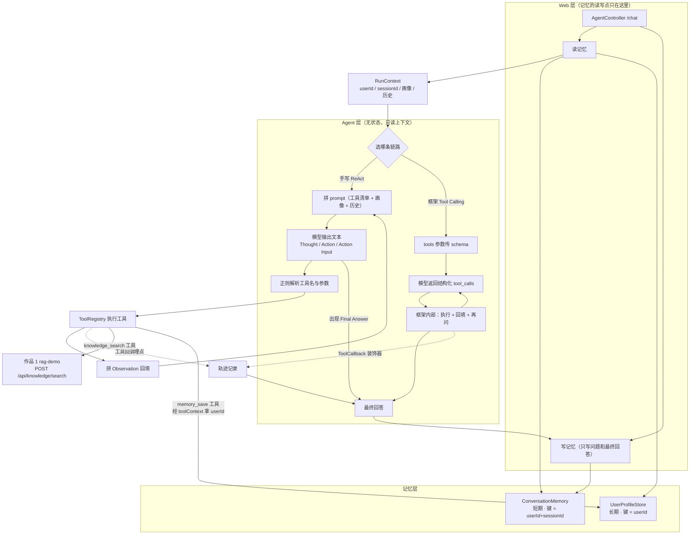

# 企业助理 Agent（Java + Spring AI）：多轮对话 + 记忆 + 工具

> 一个能查公司知识库、会算数、记得住人的企业助理 Agent。
> 核心链路**手写**（ReAct 循环 + 正则解析），同时提供 Spring AI 原生 tool calling 版本，把"框架到底替我做了什么"摆在台面上对比。

> **TODO（你来写，2–3 句）**：为什么先手写再上框架？你从中拿到了什么别的方式拿不到的东西？

## 演示

> **TODO（你来写）**：截图（多轮对话 + 右侧记忆面板）+ 30–60 秒视频链接。建议的演示动线：①「我叫张三，在技术部，2026年3月入职，记一下」→ ②「试用期能申请远程办公吗」→ ③「那转正以后呢」（靠短期记忆解指代）→ ④ 新建会话问「我入职多久了」（靠长期画像）。

## 核心特性

- **多轮对话**：会话内上下文（按轮数裁剪）+ 跨会话用户画像（部门/职位/入职时间/长期偏好），两者分开存、分开进 prompt
- **记忆写入由模型决定**：提供 `memory_save` 工具，Agent 在轨迹里看得见自己记了什么，比后台偷偷抽取好排查
- **手写 ReAct 循环**（不依赖框架）：工具清单拼进 prompt → 模型输出 `Thought/Action/Action Input` → 正则解析 → 真去执行 → 把 `Observation` 回填 → 循环到 `Final Answer`
- **框架版原生 tool calling**：工具定义走 API 的 tools 参数（结构化 schema），模型返回 `tool_calls`，执行与回填由框架完成
- **RAG 接成工具**：知识检索调用 作品 1（rag-demo）的 `POST /api/knowledge/search`，检索服务与编排服务分离，环境变量配地址
- **两条链路的轨迹都可视化**：每一步的 Thought / Action / Input / Observation / 耗时，并**标明耗时口径**（框架版测不到模型耗时，如实标注，不混着比）
- **4 个工具**：计算器（自写递归下降解析，刻意不用 eval）、当前时间、天气（示例数据）、知识库检索、记忆写入
- **工具失败不炸**：工具名写错、执行抛异常、知识库服务没起，都不往外抛，而是作为 Observation 回给模型让它自己纠正/如实说明

## 技术栈

| 层 | 选型 |
|---|---|
| 应用框架 | Spring Boot 3.5.3 / Java 17 / Spring AI 1.1.8 |
| 模型 | DeepSeek `deepseek-chat`（OpenAI 兼容协议） |
| 工具机制 | 自实现 `Tool` 接口 + Spring AI `FunctionToolCallback` / `ToolContext` |
| 检索 | 作品 1 rag-demo（pgvector + 通义 embedding），HTTP 调用 |
| 记忆 | 进程内 Map + LRU（**内存态，重启即失，见下方局限**） |
| 前端 | 原生 HTML + JS（对话页 + 记忆面板 + 对照页，无框架） |

## 架构



## 快速开始

前置：JDK 17+、Maven。**需要先跑起 作品 1（rag-demo，端口 8081）**，否则知识检索工具会返回明确的服务不可用提示。

```bash
setx DEEPSEEK_API_KEY "sk-xxx"     # 只走环境变量，不进代码/仓库
mvn spring-boot:run                # 端口 8083
# 或指定知识服务地址：
#   AGENT_KNOWLEDGE_BASE_URL=http://localhost:8082
```

打开 http://localhost:8083 → 「多轮对话」页提问，右侧实时显示长期画像和本会话历史；切到「对照实验」页可以并排看两条实现的轨迹。

命令行调试：

```bash
# 多轮对话（带记忆）
curl -X POST http://localhost:8083/api/agent/chat -H "Content-Type: application/json" \
  -d '{"sessionId":"s1","userId":"u1","question":"试用期能申请远程办公吗？","mode":"react"}'

# 看记忆里存了什么
curl "http://localhost:8083/api/agent/memory?userId=u1&sessionId=s1"

# 对照实验（无状态，每次新会话）
curl -G "http://localhost:8083/api/agent/compare" --data-urlencode "q=(1200*0.8)+50 等于多少"
```

## 实测

**接上真实 RAG 之后（2026-09-20，deepseek-chat）：**

| 问题 | 手写 ReAct | 框架版 |
|---|---|---|
| 远程办公每周几天 + 按 4.3 周折月（检索 + 计算） | 3 步 / 3633 ms | 2 次工具调用 / 3459 ms |
| 裁员赔几个月（**知识库里没有**） | 1 次检索 / 2625 ms，拒绝编造 + 标注法律常识来源 | 2 次检索 / 3528 ms，同上 |
| 试用期能否远程办公（片段里有那句关键的） | 1 次检索 / 1737 ms，答「不能」并引原文 | 2 次检索 / 3850 ms，答「不能」并引第 8 条 |

**这里推翻了一个先入为主的印象。** 早期（只有天气/计算器这类"一把过"的工具时）框架版看着更快；
接上知识库之后反过来了，Q5 是 3850ms vs 1737ms。原因不是框架慢，是**框架版自己多追加了一轮检索**
（第一次没查到满意的，换个关键词又试了一次），而手写版一查不中就直接收尾。

结论：**工具调用轮数才是耗时的主要变量，不是"手写 vs 框架"。** 多搜一轮性能上是浪费，
效果上引用往往更准——这类取舍取决于你的场景更怕浪费还是更怕漏。

**记忆部分（同一批实测）：**

| 验证项 | 结果 |
|---|---|
| 长期画像跨会话 | 新会话、零历史，问「我在哪个部门」→ 正确答出（仅凭画像） |
| 短期上下文解指代 | 「试用期能申请远程办公吗」→「那转正以后呢」→ 正确理解「那」指什么 |
| 用户隔离 | 换个 userId → 画像为空；**复用别人的 sessionId 也读不到对方历史**（这个曾经是 bug，见下） |
| 记忆裁剪 | 连问 7 轮，历史稳定在 12 条，第 1 轮被丢掉 |
| 工具 Observation 不写历史 | 检索片段动辄几百字，写进去几轮就顶满上下文 |

完整分析（含三个实测踩坑）见 [`docs/notes.md`](docs/notes.md)。

## 踩坑记录

> **TODO（你来写 A，素材在 docs/notes.md 第三节）**：`inputType(String.class)` 生成的 schema 是 `{"type":"string"}`，而 tools 协议要求参数顶层是 object，DeepSeek 直接 400。你怎么定位的（报错原文 → 对照协议 → 包一层 record → 再看轨迹里模型的调用参数变了样）？

> **TODO（你来写 B，素材在 docs/notes.md 第七节）**：三个记忆相关的坑——① 记忆键只用 sessionId 导致两个用户串数据；② 画像为空时不注入 prompt，模型编了个"我没有读取权限"的假理由；③ 模型把两组信息挤进一行 `姓名=王五, 部门=市场部`，两条事实并成一个键。你最想讲哪一个？为什么？

## 项目结构

```
src/main/java/com/example/agentdemo/
├── config/ChatConfig.java          # DeepSeek chat + ChatClient 装配
├── memory/ConversationMemory.java  # 短期记忆：会话历史 + 轮数裁剪 + 会话数 LRU
├── memory/UserProfileStore.java    # 长期记忆：用户画像（key-value），渲染进 system prompt
├── memory/ChatTurn.java            # 一轮对话（带角色，不拼成大字符串）
├── agent/ReActAgent.java           # 手写循环：prompt → 解析 → 执行 → 回填
├── agent/NativeToolAgent.java      # 框架版：FunctionToolCallback + ToolContext + 轨迹埋点
├── agent/AgentPrompts.java         # 两条路径共用的行为约束（别写成两套，吃过亏）
├── agent/RunContext.java           # 一次运行的外部上下文（谁、在哪个会话、画像、历史）
├── agent/Tool.java                 # 工具接口（含带上下文的 default 方法）
├── agent/ToolRegistry.java         # 名字查找 + 异常兜底
├── agent/AgentStep.java            # 一步轨迹（含耗时口径 costScope）
├── agent/ToolInput.java            # 框架版参数壳子（踩坑产物，见 notes.md）
├── tools/                          # calculator / current_time / weather / knowledge_search / memory_save
├── web/AgentController.java        # /chat、/memory、/react、/native、/compare、/tools
src/main/resources/
├── application.yml                 # 端口 8083、max-steps、记忆上限、知识服务地址
└── static/index.html               # 对话页 + 记忆面板 + 对照页
docs/notes.md                       # 原理笔记：两条链路差别、RAG 接工具、记忆、踩坑
```

## 已知局限（主动说，别等问）

- **记忆是进程内的**：重启即清空、多实例不共享。测试过程中我真撞到过一次——重启后问「我在哪个部门」直接变成「我这边还没有你的信息」。上生产换 Redis（会话 TTL）+ 数据库（画像），`append/history` 接口不用动。
- **历史是截断不是摘要**：超过上限的早期内容直接消失。更好的做法是小模型压缩成摘要，没做。
- **鉴权不在本项目范围**：`userId` 现在由前端传，任何能调接口的人都能声称自己是别人。键里带 userId 只是纵深防御的一层，不是安全方案。
- **没测并发**：容器层用 `synchronized` 挡了，但没有压测证据。

## 后续计划

1. **MCP**：跑通一个 MCP Server/Client，把工具通过 MCP 暴露出去
2. 记忆换 Redis，加"超长会话自动摘要"
3. 知识库多跳问题（配合 作品 1 的待办）
