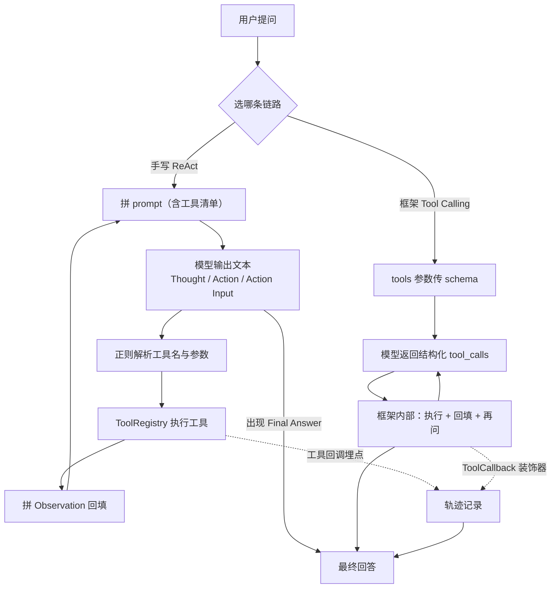

# 工具型 Agent（Java + Spring AI）：手写 ReAct vs 框架 Tool Calling

> 同一批工具、同一个模型，用两种方式实现 Agent 循环，把"框架到底替我做了什么"摆在台面上对比。

> **TODO（你来写，2–3 句）**：为什么先手写再上框架？你从中拿到了什么别的方式拿不到的东西？

## 演示

> **TODO（你来写）**：截图（左右并排的两条轨迹）+ 30–60 秒视频链接（Win+Alt+R，问一个需要两步的问题，比如"手册说每周最多几天远程办公？按 4.3 周算一个月几天？"）。

## 核心特性

- **手写 ReAct 循环**（不依赖框架）：工具清单拼进 prompt → 模型输出 `Thought/Action/Action Input` → 正则解析 → 真去执行 → 把 `Observation` 回填 → 循环到 `Final Answer`
- **框架版原生 tool calling**：工具定义走 API 的 tools 参数（结构化 schema），模型返回 `tool_calls`，执行与回填由框架完成
- **两种实现的轨迹都可视化**：每一步的 Thought / Action / Input / Observation / 耗时，并**标明耗时口径**（框架版测不到模型耗时，如实标注，不混着比）
- **4 个工具**：计算器（自写递归下降解析，刻意不用 eval）、当前时间、天气（示例数据）、员工手册检索
- **工具失败不炸**：工具名写错、执行抛异常，都不往外抛，而是作为 Observation 回给模型让它自己纠正

## 技术栈

| 层 | 选型 |
|---|---|
| 应用框架 | Spring Boot 3.5.3 / Java 17 / Spring AI 1.1.8 |
| 模型 | DeepSeek `deepseek-chat`（OpenAI 兼容协议） |
| 工具机制 | 自实现 `Tool` 接口 + Spring AI `FunctionToolCallback` |
| 前端 | 原生 HTML + JS（并排对比页，无框架） |

## 架构



## 快速开始

前置：JDK 17+、Maven

```bash
setx DEEPSEEK_API_KEY "sk-xxx"     # 只走环境变量，不进代码/仓库
mvn spring-boot:run                # 端口 8083
```

打开 http://localhost:8083 → 输入问题 → 点「两个都跑」→ 左右并排看轨迹。

命令行调试：

```bash
curl -G "http://localhost:8083/api/agent/react"  --data-urlencode "q=杭州今天天气怎么样？"
curl -G "http://localhost:8083/api/agent/native" --data-urlencode "q=(1200*0.8)+50 等于多少"
curl -G "http://localhost:8083/api/agent/compare" --data-urlencode "q=手册说每周最多几天远程办公？按4.3周算一个月几天？"
```

## 实测对比

| 问题 | 手写 ReAct | 框架版 |
|---|---|---|
| 手册查远程办公天数 + 按 4.3 周折算（两步：检索 + 计算） | 3 步 / 2287 ms | 2 次工具调用 / 3345 ms |
| 杭州今天天气 | 2 步 / 1434 ms | 1 次调用 / 1342 ms |
| (1200\*0.8)+50 | 2 步 / 1062 ms | 1 次调用 / 1159 ms |

两个实现都正确完成了多步推理，没有跳过工具直接编答案。**耗时口径不同**（手写版含模型调用，框架版只含工具执行），不能当性能结论用——完整分析见 [`docs/notes.md`](docs/notes.md)。

## 踩坑记录

> **TODO（你来写，素材在 docs/notes.md 第三节）**：`inputType(String.class)` 生成的 schema 是 `{"type":"string"}`，而 tools 协议要求参数顶层是 object，DeepSeek 直接 400。你怎么定位的（报错原文 → 对照协议 → 包一层 record → 再看轨迹里模型的调用参数变了样）？

## 项目结构

```
src/main/java/com/example/agentdemo/
├── config/ChatConfig.java        # DeepSeek chat + ChatClient 装配
├── agent/ReActAgent.java         # 手写循环：prompt → 解析 → 执行 → 回填
├── agent/NativeToolAgent.java    # 框架版：FunctionToolCallback + 轨迹埋点
├── agent/Tool.java               # 工具接口：同一批实现被两种 Agent 复用
├── agent/ToolRegistry.java       # 名字查找 + 异常兜底
├── agent/AgentStep.java          # 一步轨迹（含耗时口径 costScope）
├── agent/ToolInput.java          # 框架版参数壳子（踩坑产物，见 notes.md）
├── tools/                        # calculator / current_time / weather / handbook_search
├── web/AgentController.java      # /react、/native、/compare、/tools
src/main/resources/
├── application.yml               # 端口 8083、max-steps、DeepSeek 配置
├── static/index.html             # 并排对比页
└── knowledge/handbook.md         # 检索用示例语料
docs/notes.md                     # 原理笔记：两条链路差别、实测、踩坑
```

## 后续计划（W4：作品 2）

1. **会话记忆**：现在的 Agent 是无状态的，每问一句都是新会话。要做多轮（会话上下文 + 用户画像）
2. **把 `handbook_search` 换成真实 RAG**：改成调用 rag-demo 的检索接口——工具接口不变，Agent 侧一行不用改（这正是工具抽象的价值）
3. **MCP**：跑通一个 MCP Server/Client，把工具通过 MCP 暴露出去
